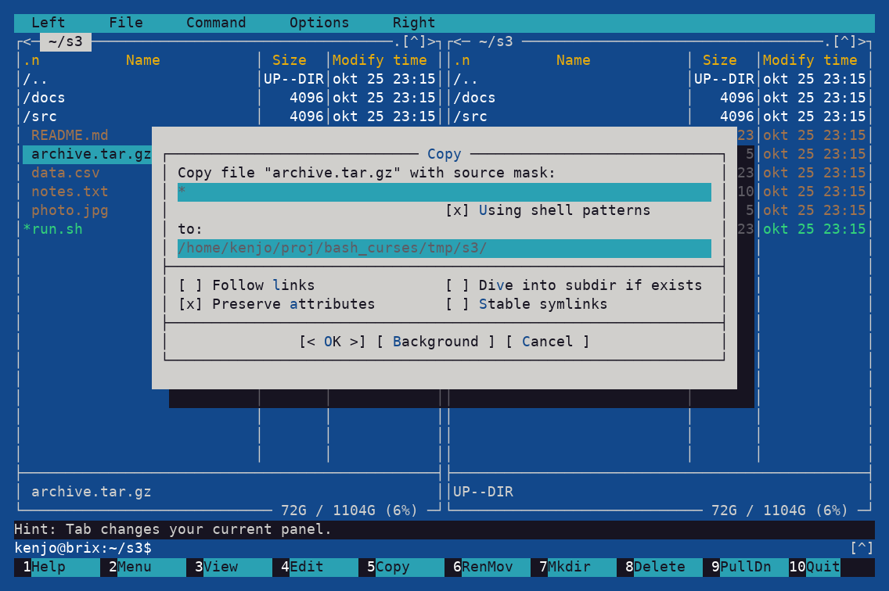
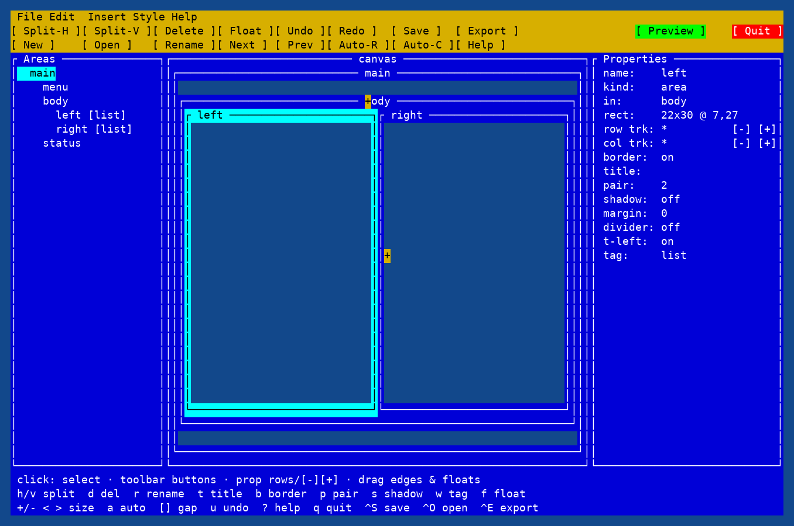

# bash_curses

**Full-screen terminal apps in pure bash — with the ncurses API you already know.**

<p align="center">
  
  <br>
  <sub>Midnight Commander clone (`apps/mc-layout.sh`) with the Copy dialog.</sub>
</p>

No C extension. No Python runtime. No system ncurses. Source one bash library and
write windows, colors, keyboard input, mouse events, dialogs, and layout-driven
terminal UIs.

```bash
source lib/bc.sh

initscr || exit 1
start_color
init_pair 1 $COLOR_CYAN $COLOR_BLACK
mvwaddstr $BC_STDSCR 0 0 "Hello from bash"
refresh
wgetch
endwin
```

Run it with `bash hello.sh`. `endwin` is installed from an EXIT trap, so the
terminal is restored even if the script dies.

## [Notes from the prompter (formerly known as the programmer)](#notes-from-the-prompter-formerly-known-as-the-programmer)

## Why bash_curses

- **Familiar API**: `initscr`, `newwin`, `waddstr`, `wgetch`, `wrefresh`,
  attributes, colors, pads, subwindows, and mouse events.
- **Optional higher layers**: layout templates, widgets, and `dialog`-style
  prompts so most apps do not compute coordinates.
- **Real terminal behavior**: keyboard, mouse, resize, colors, and thin
  wide-character helpers.
- **Finished apps included**: Midnight Commander clones, dual tail, layout demos,
  and a layout builder.
- **Single-file distribution**: bundle the libraries into one script.
- **Tested**: headless unit tests plus integration tests.

User documentation lives in [`docs/`](docs/README.md). Contributor notes live in
[`internal/`](internal/README.md).

## Requirements

- bash >= 4.3, `stty`, `tput`, `infocmp`
- a terminal emulator for running apps

## Try the showcase apps

```sh
bash apps/mc-layout.sh
```

Other apps:

```sh
bash apps/mc.sh
bash apps/newdemo.sh
bash apps/shining.sh
bash apps/shining-layout.sh
bash apps/dtail.sh
```

## The layers

| Layer | File | What it gives you |
|---|---|---|
| Dialog | `lib/dialog.sh` | `dialog`-style msgbox / yesno / menu prompts |
| Widgets | `lib/widgets.sh` | lists, menu bars, dialogs, input fields, buttons |
| Layout | `lib/layout.sh` | named screen areas, floats/dialogs, event loop |
| Core | `lib/bc.sh` | ncurses-style API: windows, attributes, keys, mouse |
| Builder | `tools/bcbuild.sh` | interactive layout designer → [docs/builder.md](docs/builder.md) |

Source the topmost layer you need; each sources the layers below it. The layout
layer turns a template of area names into windows, keeps them laid out across
resizes, and redraws only what changed:

```bash
source lib/layout.sh
bc_init mouse
init_pair 1 7 4; init_pair 2 0 6

bc_screen "
  menu  menu
  left  right
  keys  keys
" rows="1 * 1" cols="* *"

bc_style menu pair=2
bc_style left  pair=1 border title=Left
bc_style right pair=1 border title=Right
bc_text  menu  " File  Command  Options"

draw_left() { bc_print left 0 0 "drawn by name, no coordinates"; }
on_key()    { [[ $1 == q ]] && bc_quit; }
bc_run
```

Full references:

- [docs/bc.md](docs/bc.md) — core ncurses-style API
- [docs/layout.md](docs/layout.md) — layout templates, floats, event loop
- [docs/widgets.md](docs/widgets.md) — lists, menu bars, dialogs
- [docs/dialog.md](docs/dialog.md) — msgbox / yesno / menu prompts
- [docs/mouse.md](docs/mouse.md) — mouse semantics and `bstate` table
- [docs/tutorial-dtail.md](docs/tutorial-dtail.md) — building a dual tail app
- [docs/builder.md](docs/builder.md) — interactive layout builder

## Design layouts visually

`tools/bcbuild.sh` is an interactive layout designer: split areas, drag track
boundaries, set borders/titles/colors, add floats, then save a `.bcl` project or
export a runnable app skeleton.

<p align="center">
  
  <br>
  <sub>`bcbuild` designing a nested two-pane layout.</sub>
</p>

```sh
bash tools/bcbuild.sh
```

Details: [docs/builder.md](docs/builder.md).

## Apps and examples

`apps/` holds finished showcase programs:

- `apps/newdemo.sh` — color/window demo ported from ncurses `newdemo`.
- `apps/shining.sh` — overlapping windows typing the same sentence.
- `apps/shining-layout.sh` — `shining.sh` rebuilt with `lib/layout.sh`.
- `apps/mc.sh` — Midnight Commander clone built on `lib/bc.sh`.
- `apps/mc-layout.sh` — the same clone rebuilt on `lib/layout.sh` +
  `lib/widgets.sh`.
- `apps/dtail.sh` — dual tail app built with `lib/layout.sh`.

`examples/` holds small ports of ncurses test-suite demos, plus
`examples/90-layout.sh` as a layout-layer example. The numbered examples are
smoke-tested by `tests/examples.sh`. Current accepted differences from
the C reference binaries are listed in
[`internal/example-deviations.md`](internal/example-deviations.md).

## Mouse

`wgetch` intercepts SGR 1006 and X10 mouse reports, merges press+release into
CLICK and CLICK runs into DOUBLE/TRIPLE, filters by the `mousemask`, and returns
`KEY_MOUSE`; `getmouse` then drains the queue into
`BC_ME_ID`/`BC_ME_X`/`BC_ME_Y`/`BC_ME_BSTATE`. `bstate` uses the ncurses
mouse-version-2 encoding; wheel up/down are buttons 4/5. Full user-facing
semantics and the bstate table: [docs/mouse.md](docs/mouse.md).

## Not a 1:1 ncurses clone

`bash_curses` covers the parts of the ncurses API exercised by the reference
corpora, includes thin single-cell wide-character wrappers, and excludes the
terminfo API. Bash has no return values, pointers, or out-parameters, so results
come back in globals (`wgetch` → `key`, `newwin` → `bc_win`, `getmaxyx` →
`BC_GMY`/`BC_GMX`, …) and the pair is a separate argument to
`wattrset`/`wbkgd`. Never use command substitution for library calls.

The full list — including `mousemask`'s old-mask argument, pair 0 being a real
pair, `wcwidth`'s status return, and what is not implemented — is in
[docs/bc.md](docs/bc.md#deviations-and-gaps). Read it before porting C code.

## Distributing your app

Ship a single self-contained script by embedding the libraries into it, and
split it back apart whenever you want:

```sh
bash lib/bc.sh bundle myapp.sh -o myapp      # one file to distribute
bash lib/bc.sh unbundle myapp -o outdir/     # script + lib files again
```

Details: [docs/distributing.md](docs/distributing.md).

## Testing

```sh
bash tests/run.sh
```

The suite includes headless unit tests, integration tests, example smoke
tests, and app regression tests. Details:
[internal/testing.md](internal/testing.md).

## Repo layout

```text
lib/bc.sh        the library (source it)
lib/layout.sh    optional layout layer: templates, floats, draw by name, bc_run
lib/widgets.sh   optional widgets on top of layout: lists, menubar, dialogs
lib/dialog.sh    optional dialog layer on top of widgets: msgbox, yesno, menu
docs/            user tutorials + API reference for each layer (start at docs/README.md)
internal/        contributor notes: design, testing, mouse internals, parity, API matrix
apps/            finished showcase apps: mc, newdemo, shining, dtail
examples/        small ncurses API demos and layout examples
tests/           run.sh, unit*.sh, integration.sh, examples, mc_*, app tests
AGENTS.md        working conventions for this repo
```

## Notes from the prompter (formerly known as the programmer)

So this started when I noticed that dialog was not installed on a computer. After that shock there was no other way than to prompt the AI for a solution.

So it did not really start as any formed plan it was first just a way to find out what alternatives to dialog exist (whiptail) but spiraled out of control. Once I committed to try to do this it was clear that I'm not going to write or even look at the code so this is truly a vibe coded project. Now this was definitely not one of the YouTube vibes where they write one prompt and get a result. In total it took 784 prompts and several hours of my time. It's a bit annoying to control the AI when you want a specific outcome. If you don't care like all YouTubers then sure write one prompt but it's not really going to be a very useful result. 

## issues 

### 1. price
So this was intended to use a local AI but I messed up and by mistake got a prompt in that used Anthropic claude-opus 5.5. That by itself killed my monthly GitHub Copilot Pro+ subscription. That subscription gives 7000 credits and this mistake ate up almost 6000 of them.

So this notion that you can actually get anything real done with a monthly plan is a total joke. This is equal to you renting an apartment/house and the electric bill is included in the rent just to have the power shut down after 2 days. I think they have to change model here the real cost of use is nowhere near the credits you get in the different plans.

Models actually used per assistant turn (14,007 turns total):

| Model | Turns | Cost |
|---|---|---|
| strata/qwen3.8-flash-next | 8,743 | $155.00 |
| llama-cpp/qwen38-27b-mtp | 3,297 | $115.01 |
| llama-cpp/qwen38-27b-mtp-balanced | 1,051 | $27.19 |
| llama-cpp/qwen38-27b-mtp-fast | 583 | $16.47 |
| github-copilot/claude-opus-5.5 | 333 | $47.36 |


### 2. time
The AI have no concept of time constantly say it's done when the actual implementation is totally unusable. The first version of the mc clone that actually displayed anything had a 3 seconds delay trying to move the active line one row down/up. No human on earth would have said they had a working program with that behaviour. And it came up over and over no matter how many times the speed came up as an issue it just never learned.

## 3. colors 
Again same as with time. Confidently declare that the background is indeed blue when I'm staring at a red one. And even after I wrote that it was wrong it comes back and say that no I'm the one that is wrong. Luckily the qwen3.8-flash-next has an image model so I could just take a screenshot and paste it in the prompt. That usually at least makes it understand that there is indeed a problem but then it creates a new color problem the next try. 

## Session usage totals

Recorded opencode usage for this project (20 sessions):

Costs are **not** real billing. This was mostly done on a local model. `strata/qwen3.8-flash-next`. The cost is just made up. I copied it from some price list do not remember where I got the numbers. 

 `$3.00 / 1M input tokens, $15.00 / 1M output`

(cache read/write are not priced, so they count as $0). For reference, $3/$15 is Anthropic's *Sonnet*-class list price, 

| metric | value |
|---|---|
| cost (USD) | 360.5487 |
| sessions | 20 |
| input tokens | 45,284,163 |
| output tokens | 12,106,604 |
| reasoning tokens | 170,853 |
| subtotal (in+out+reason) | 57,561,620 |
| cache read tokens | 950,330,124 |
| cache write tokens | 3,763,576 |

### What the same usage would have cost on other models

Same token usage (input 45.3M, output+reasoning 12.3M, cache read 951M, cache write 3.8M) priced at each provider's first-party list rate. These providers **do** charge for cache reads (discounted) and cache writes (premium), so the 951M cached tokens dominate. Prices from the bundled models.dev catalog (snapshot dated **2026-10-26**; prices valid as of that date and subject to change); "—" = that provider does not bill cache writes.

| Model | $/M in | $/M out | $/M cache read | $/M cache write | Est. cost |
|---|---|---|---|---|---|
| Your config (strata/qwen3.8-flash-next) | 3.00 | 15.00 | 0 (free) | 0 (free) | **$320.29** |
| Claude Opus 5 (anthropic) | 5.00 | 25.00 | 0.50 | 6.25 | **$1,032.99** |
| Claude Sonnet 5 (anthropic) | 2.00 | 10.00 | 0.20 | 2.50 | **$413.20** |
| GPT-5.5 (openai) | 5.00 | 30.00 | 0.50 | — | **$1,070.92** |
| Gemini 4 Argon (google) | 2.00 | 10.00 | 0.10 | — | **$308.66** |
| DeepSeek V4 Pro (deepseek) | 0.66 | 1.98 | 0.022 | — | **$75.17** |


### Where the time went (model vs tools)
I'm not sure how accurate this info is as it's not something that opencode has any
stats for as default. It's collected from the opencode.db and mistakes could have been made. But It's possible the first prompt was 2026-10.04 and last 2026-10.26.

Wall-clock timings from part/message timestamps across all sessions
(13,997 assistant turns; idle gaps between turns not counted).

| Bucket | Time |
|---|---|
| Model — thinking (reasoning) | 31h 25m |
| Model — writing (text + tool-call args) | 18h 59m |
| **Model total** | **50h 24m** |
| **Tools running** | **62h 24m** |

Tool time breakdown:

| Tool | Time | Calls |
|---|---|---|
| bash | 26h 09m | 7,669 |
| question | 23h 07m | 39 |
| read | 8h 27m | 3,083 |
| task (subagents) | 4h 35m | 17 |
| grep / edit / write / webfetch / glob / todowrite | ~6m total | ~3,100 |

Caveats: `question` (23h) is the model waiting for prompt answers, not compute —
excluding it, real tool compute is ~34h 43m. `task` (4h 35m) is subagent
wall-clock that overlaps the subagent sessions' own time, so it is partly
double-counted.
